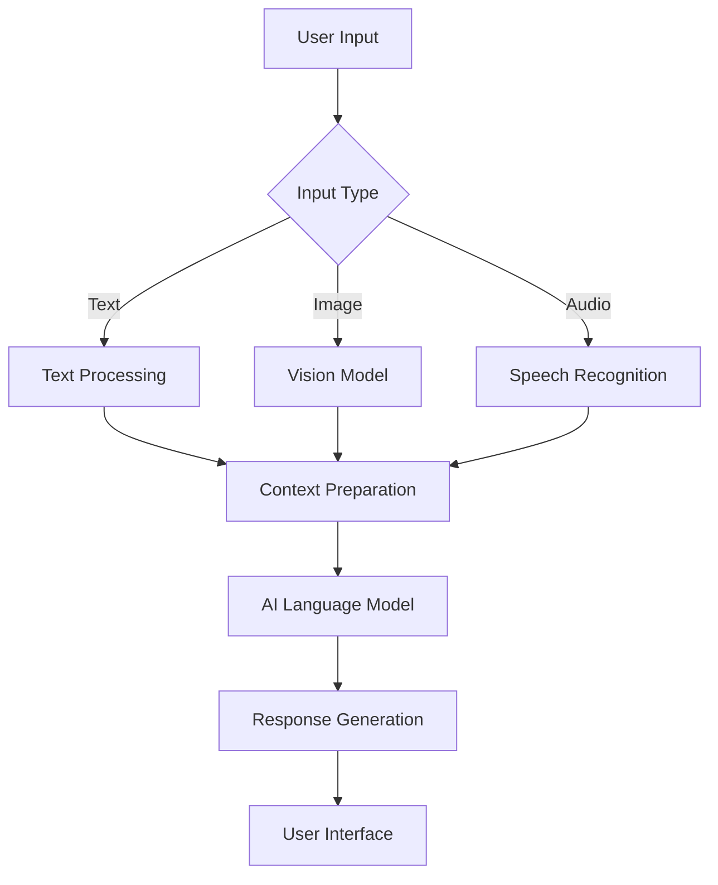

# 🤖 Multimodel AI Assistant

### An Intelligent AI Assistant for Multimodal Interaction


**Multimodel AI Assistant** is an AI-powered application exploring how different forms of information—such as text, images, and speech—can be processed to enable more natural and intelligent human–computer interactions.

The project aims to bring multiple AI capabilities into a unified assistant, making it easier to experiment with language models, multimodal understanding, and conversational AI.

> **Project note:** The features and architecture below describe the intended system. Update them to reflect the capabilities currently implemented in the repository.

---

## 📌 Project Overview

Traditional AI chatbots primarily interact through text. Multimodal AI systems extend these capabilities by allowing users to interact through different input formats.

This project explores an assistant that can:

- 💬 Understand and respond to natural-language queries.
- 🖼️ Interpret images and visual information.
- 🎙️ Process speech-based interactions.
- 🧠 Generate context-aware responses using AI models.
- 🔄 Combine different input modalities into a unified workflow.

The goal is to build a flexible foundation for experimenting with modern Generative AI applications.

## ✨ Key Features

| Feature | Description |
|---|---|
| 💬 Conversational AI | Natural-language interaction powered by language models |
| 🖼️ Image Understanding | Visual analysis and image-based question answering |
| 🎙️ Speech Processing | Voice input and speech-to-text capabilities |
| 🧠 Contextual Reasoning | Generate responses based on user queries and available context |
| 🔗 Multimodal Integration | Combine text, image, and audio processing workflows |
| 🧩 Modular Architecture | Extend or replace individual AI components |

*Confirm which features are implemented before presenting them as completed functionality.*

## 🏗️ System Architecture

The proposed system processes user inputs through modality-specific components before generating a response.



### How It Works

1. **Input:** The user submits a text query, image, or audio input.
2. **Processing:** The relevant processing component extracts information from the input.
3. **Context preparation:** The extracted information is organized for the language model.
4. **AI inference:** The model interprets the information and generates a response.
5. **Output:** The assistant presents the result through the application interface.

## 🛠️ Technology Stack

The following technologies are suitable for a multimodal AI assistant. Replace this table with the actual dependencies used in the project.

| Component | Potential Technologies |
|---|---|
| Programming Language | Python |
| Language Models | OpenAI, Gemini, or open-source LLMs |
| AI Frameworks | LangChain, Hugging Face Transformers |
| Speech Recognition | Whisper or other speech-to-text models |
| Computer Vision | Vision-language models |
| User Interface | Streamlit, Gradio, or a web frontend |
| Deep Learning | PyTorch |

## 📂 Project Structure

The following is an illustrative structure, not a verified listing of repository files.

```text
Multimodel_AI_Assitant/
│
├── app.py                 # Main application
├── models/                # AI model integrations
├── services/              # Processing services
├── utils/                 # Shared utilities
├── assets/                # Images and other resources
├── requirements.txt       # Python dependencies
├── .env.example           # Example configuration
├── .gitignore
└── README.md
```

## ⚙️ Installation and Setup

### 1. Clone the Repository

```bash
git clone https://github.com/DhrumilPrajapati03/Multimodel_AI_Assitant.git
cd Multimodel_AI_Assitant
```

### 2. Create a Virtual Environment

```bash
python -m venv venv
```

Activate the environment.

**Windows:**

```bash
venv\Scripts\activate
```

**Linux / macOS:**

```bash
source venv/bin/activate
```

### 3. Install Dependencies

If the repository contains a `requirements.txt` file:

```bash
pip install -r requirements.txt
```

### 4. Configure Environment Variables

If the application uses external AI services, configure the required credentials using the application's supported configuration method.

Never commit API keys, passwords, or other secrets to GitHub.

### 5. Run the Application

Use the entry point defined in the source code. For example, if the project uses Streamlit:

```bash
streamlit run app.py
```

Or, if it uses a standard Python entry point:

```bash
python app.py
```

These commands are examples and should be verified against the repository.

## 💡 Example Use Cases

### 💬 Natural Language Interaction

**User:** Explain how neural networks learn.

**Assistant:** Provides an explanation of neural networks, training, and backpropagation.

### 🖼️ Visual Question Answering

**User:** What objects are present in this image?

**Assistant:** Analyzes the image and describes its visible contents.

### 🎙️ Voice Interaction

**User:** Asks a question through a microphone.

**Assistant:** Converts the speech into text, processes the query, and generates a response.

*These examples illustrate intended behavior and are not verified outputs from the application.*

## 🚀 Future Enhancements

- [ ] Add support for additional vision-language models.
- [ ] Implement real-time voice conversations.
- [ ] Introduce conversational memory.
- [ ] Integrate Retrieval-Augmented Generation (RAG).
- [ ] Support PDF and document understanding.
- [ ] Improve multilingual interaction.
- [ ] Add model evaluation and benchmarking.
- [ ] Containerize the application using Docker.
- [ ] Implement automated testing and CI/CD.
- [ ] Deploy the assistant as a publicly accessible application.

## 🤝 Contributing

Contributions, suggestions, and improvements are welcome.

1. Fork the repository.
2. Create a feature branch.
3. Make your changes.
4. Commit your improvements.
5. Push your branch.
6. Open a pull request describing your changes.

## 👨‍💻 Author

**Dhrumil Prajapati**

AI Engineer | Generative AI | LLMs | RAG | Agentic AI

- **GitHub:** [DhrumilPrajapati03](https://github.com/DhrumilPrajapati03)
- **Portfolio:** [dhrumilbuilds.in](https://dhrumilbuilds.in)

---

### ⭐ Support the Project

If you find this project useful, consider giving the repository a star.

**Exploring intelligent AI interactions across multiple modalities.**
